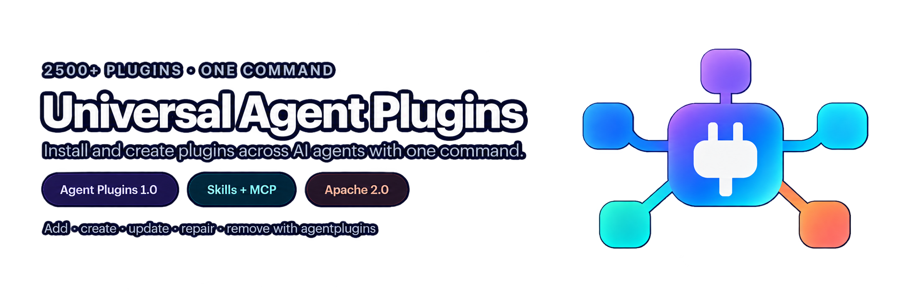
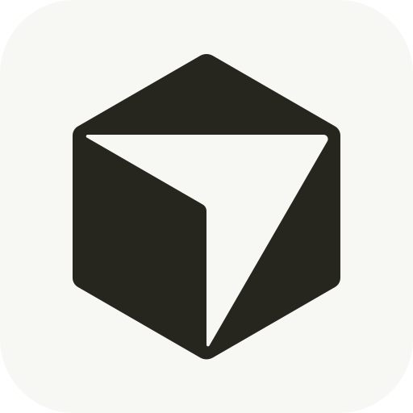
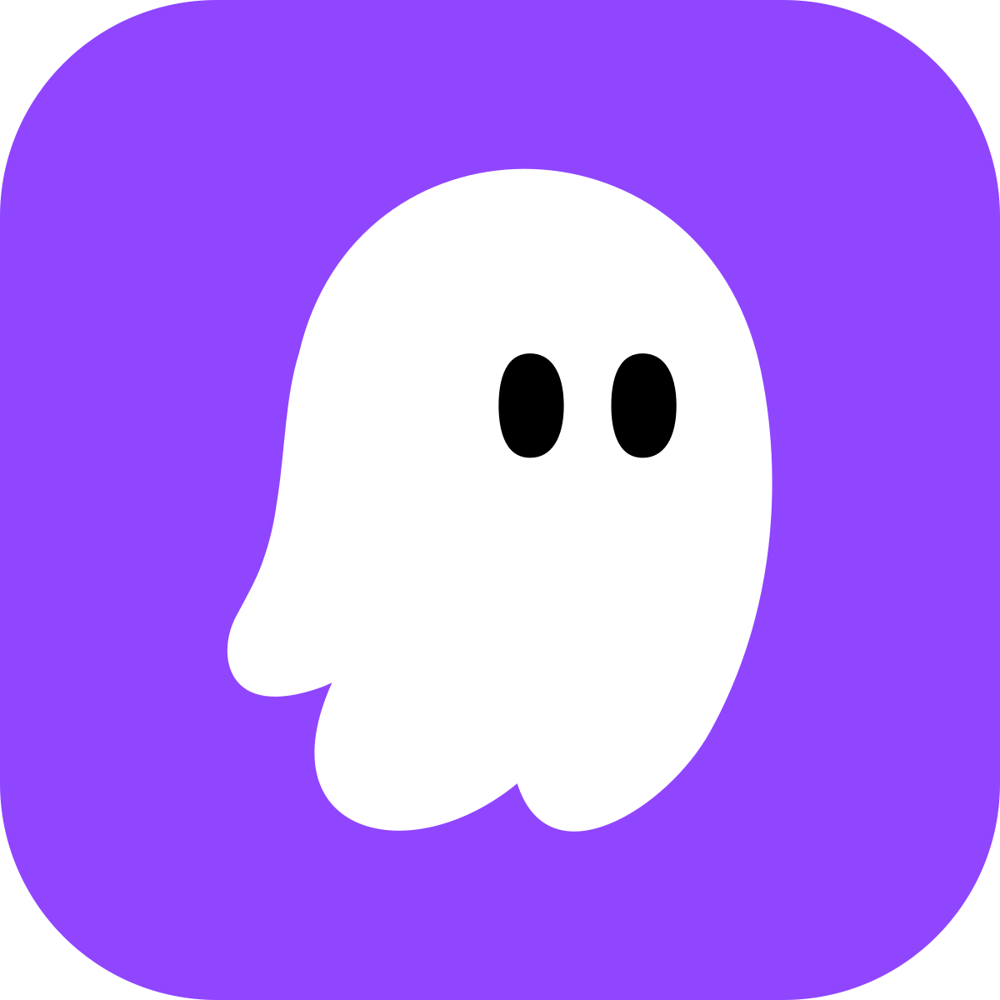
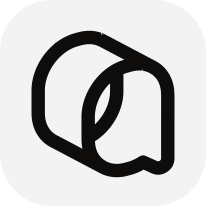
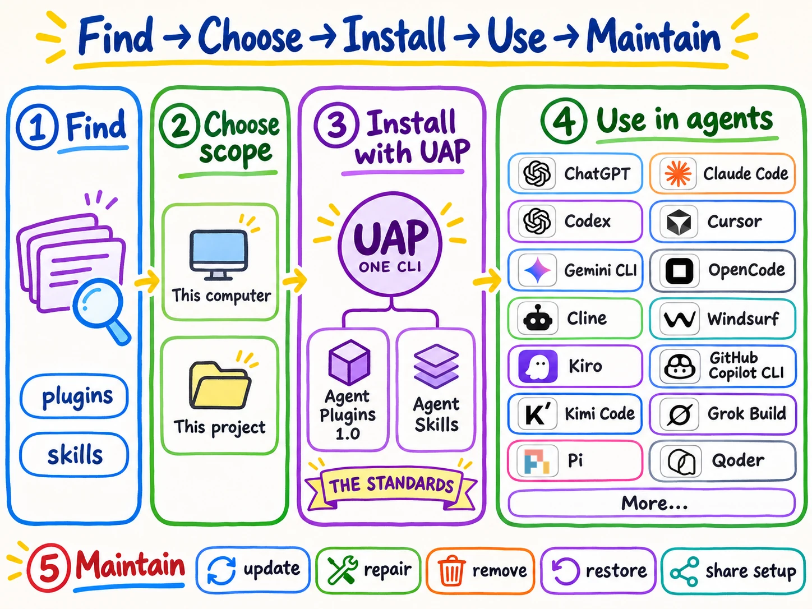
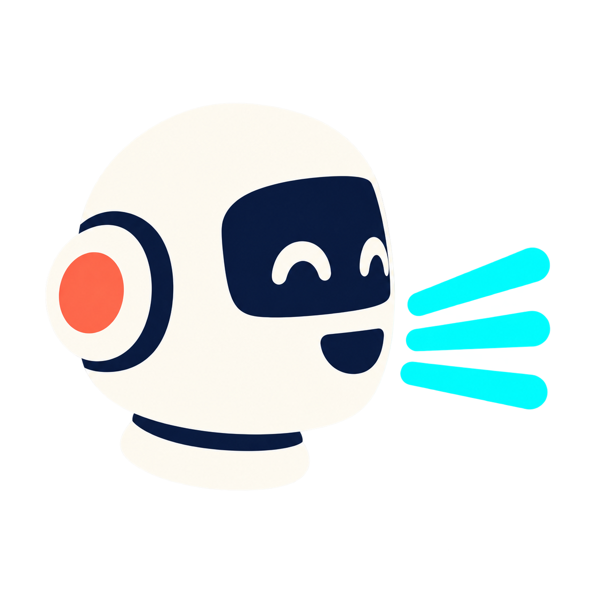

<p align="center">
    &nbsp;&nbsp;
    &nbsp;&nbsp;
    &nbsp;&nbsp;
    &nbsp;&nbsp;
    &nbsp;&nbsp;
    &nbsp;&nbsp;
    <picture><source media="(prefers-color-scheme: dark)" srcset="assets/client-icons/opencode-dark.svg"></picture>&nbsp;&nbsp;
    <picture><source media="(prefers-color-scheme: dark)" srcset="assets/client-icons/cline-dark.svg"></picture>&nbsp;&nbsp;
    <picture><source media="(prefers-color-scheme: dark)" srcset="assets/client-icons/windsurf-dark.svg"></picture>&nbsp;&nbsp;
    <picture><source media="(prefers-color-scheme: dark)" srcset="assets/client-icons/grok-dark.svg"></picture>&nbsp;&nbsp;
    <picture><source media="(prefers-color-scheme: dark)" srcset="assets/client-icons/kimi-dark.svg"></picture>&nbsp;&nbsp;
    &nbsp;&nbsp;
    &nbsp;&nbsp;
    &nbsp;&nbsp;
    
</p>

[](https://github.com/777genius/universal-agent-plugins/actions/workflows/ci.yml)
[](https://codecov.io/gh/777genius/universal-agent-plugins)
[](https://www.npmjs.com/package/universal-agent-plugins)
[](https://agent-plugins.org/specification)
[](https://agentskills.io/specification)
[](LICENSE)

Install and manage plugins and Skills across your AI agents with one CLI.
Share `uap.toml` (package list) and `uap.lock` (exact versions) to restore your
setup on another computer or with your team.

**More than a one-time installer:** UAP combines a [searchable plugin directory](https://universal-agent-plugins.com/plugins/), independent [Agent Skills](https://universal-agent-plugins.com/agent-skills/) (no `plugin.json` wrapper needed), native multi-agent installation, managed repair/removal, portable dependency locks, and [Go/TypeScript SDKs](https://universal-agent-plugins.com/docs/en/sdk/). Review [product capabilities and release boundaries](docs/PRODUCT_CAPABILITIES.md) for evidence and limitations.

[Documentation](https://universal-agent-plugins.com/docs/) ·
[Browse plugins](https://universal-agent-plugins.com/plugins/) ·
[Build a plugin](#build-plugins)

<p align="center">
<a href="https://universal-agent-plugins.com/#demo" title="Watch the Universal Agent Plugins demo"></a>
</p>

<p align="center">
  
</p>

## Contents

- [Use plugins](#use-plugins)
  - [Quick start](#quick-start)
  - [Install the CLI](#install-the-cli)
- [What the CLI does](#what-the-cli-does)
- [More capabilities](#more-capabilities)
- [Install for one project](#install-for-one-project)
- [Restore your plugin setup](#restore-your-plugin-setup)
- [Install from other sources](#install-from-other-sources)
- [Supported clients](#supported-clients)
- [More commands](#more-commands)
- [Find and verify plugins](#find-and-verify-plugins)
- [Safe updates and removal](#safe-updates-and-removal)
- [SDKs and integrations](#sdks-and-integrations)
- [Build plugins](#build-plugins)
- [Contributing](#contributing)
- [License](#license)

## Use plugins

### Quick start

Install a [supported agent](#supported-clients) first. Then, with Node.js 22+,
add Context7:

```bash
npx universal-agent-plugins add context7
```

Choose from the detected agents, follow any sign-in or approval steps, then
start a new session. This installs for your user account. To keep plugins in
one repository, use [project installation](#install-for-one-project).

**Choose your agents**


**Review the installation plan — Playwright example**


**Follow installation progress — Playwright example**


### Install the CLI

Choose one method. Only npm requires Node.js; Homebrew and the native scripts
do not.

**macOS and Linux — Homebrew:**

```bash
brew install 777genius/agentplugins/agentplugins
agentplugins add context7
```

**macOS and Linux — native installer:**

```bash
curl -fsSL https://raw.githubusercontent.com/777genius/universal-agent-plugins/main/install.sh | sh -s -- add context7
```

**Windows — PowerShell:**

```powershell
irm https://raw.githubusercontent.com/777genius/universal-agent-plugins/main/install.ps1 | iex
& "$HOME\.local\bin\agentplugins.exe" add context7
```

**npm — Node.js 22+:**

```bash
npm install -g universal-agent-plugins
agentplugins add context7
```

The native scripts verify the download's checksum and version, then install to
`$HOME/.local/bin`. Add that directory to `PATH` to use `agentplugins` by name.
Plugins may need additional runtimes; see [installation help](docs/NATIVE_INSTALL.md).

For the latest stable native installer, see [GitHub Releases](https://github.com/777genius/universal-agent-plugins/releases/latest).
Check `agentplugins version`: npm and Homebrew can lag behind native releases.
Code in `main` may not be released yet.

## What the CLI does

- Installs supported package components in one or more agents.
- Records exact versions for repeatable installs.
- Updates, repairs, and removes managed files without overwriting unrelated content.
- Reports any remaining approval, sign-in, or reload steps.

## More capabilities

For AI-agent / headless installation, see the [agent-first CLI guide](docs/AGENT_CLI.md): explicit targets and scope, read-only Skills discovery, JSON results, and lifecycle verification. New source-only commands are labelled separately from released CLI behavior.

| Need | How UAP helps |
| --- | --- |
| Multiple agents | `add --target codex,claude` with separate outcomes and any remaining activation steps. |
| Standalone Skills | `skills add` with a browser picker or explicit `--skill` selections; see [Skills installation](https://universal-agent-plugins.com/docs/en/use/install.html#install-agent-skills). |
| Sources outside the registry | Reviewed local package directories, Git/SSH sources and complete ZIP/TAR archives; see [source formats](docs/DIRECT_PACKAGE_SOURCES.md). |
| Team/project reproducibility | Commit `uap.toml` and `uap.lock`, then run `install --locked --scope project`. |
| Moving a user setup | `deps export` and `deps import --install`; no credentials or live data are exported. |
| Maintenance | `doctor`, `outdated`, `update --dry-run`, `repair --dry-run`, explicit remove and scope flags. |
| Application integration | [Go Installer](https://universal-agent-plugins.com/docs/en/sdk/go-installer.html) or [TypeScript Management SDK](https://universal-agent-plugins.com/docs/en/sdk/typescript-management.html). |
| Typed agent callbacks | [Go Hooks SDK](https://universal-agent-plugins.com/docs/en/sdk/go-hooks.html), with event- and release-specific support. |

File preparation, native activation, MCP execution and authentication are
separate checkpoints. Check each target's result after a multi-agent operation.

## Install for one project

Use `--scope project` (CLI 0.1.93+) to install in one repository without changing
your user setup.

**Signed Directory short names**

Merged installer PR #725 supports explicit Project placement for an eligible
signed package and its required dependencies, using each selected client's
real Project capabilities. Historical User runtime evidence is not Project
activation evidence. In the published stable CLI:

```sh
cd /path/to/project
agentplugins add context7 --target codex --scope project --dry-run
```

Review the plan before omitting `--dry-run`. Unsupported clients or mandatory
components fail closed; there is no implicit User fallback.

**Alternative: exact Git source.** For reproducibility, copy a compatible,
commit-pinned Git source from the [catalog](https://universal-agent-plugins.com/plugins/)
and replace the placeholders:

```sh
cd /path/to/project
agentplugins add github:OWNER/REPOSITORY@FULL_COMMIT_SHA//PACKAGE_PATH \
  --scope project --target codex
```

Use a full 40-character commit SHA; omit `//PACKAGE_PATH` for a root package.
Direct Git is an alternative to a signed Directory alias. Neither
route bypasses native client trust or complete dependency authorization.

**Share and restore**

Commit the generated `uap.toml` and `uap.lock`; add `.uap/` to `.gitignore`.
In another checkout, install UAP and the required agents, then run from the
project root:

```sh
agentplugins install --locked --scope project
```

`--locked` requires a lockfile matching the manifest and restores its exact versions.

**Add standalone Skills**

```sh
agentplugins skills add owner/repository --ui --scope project
```

Use a real Skills repository; `--ui` opens a browser picker. Outside the project,
add `--project-root /path/to/project`.

Always include `--scope project` with add, update, repair, and remove. Otherwise,
they use your user setup—even inside the project.

ChatGPT has no native project installation. See the
[project guide](docs/PROJECT_INSTALLATION.md) for maintenance and the
[project support table](docs/PROJECT_CLIENT_SUPPORT.md) for each agent's limits.

## Restore your plugin setup

Export your saved user-wide setup to an empty folder:

```sh
agentplugins deps export /path/to/transfer
```

Copy `uap.toml` and `uap.lock` to the new computer, install UAP and the required
agents, then import from the folder containing those files:

```sh
agentplugins deps import /path/to/transfer --install
```

Only `uap.toml` and `uap.lock` travel. These commands use your user setup, not a
project's. Sign-ins, secrets, agent settings, and plugin data need separate setup
or backup. Packages must remain available from their sources or the destination
cache; this is not an offline backup.

Check supported agents with `agentplugins deps status`.
[Dependency guide](docs/UAP_DEPENDENCIES.md) ·
[Import and recovery](https://universal-agent-plugins.com/docs/en/use/manage.html#restore-on-another-machine)

<a id="any-agent-plugins-10-package"></a>

## Install from other sources

Install an Agent Plugins 1.0 package from a local folder, Git (HTTPS or SSH),
or a ZIP/TAR/TAR.GZ archive (local or HTTPS). No catalog entry is required.
Only `plugin.json` is supported as the package manifest:

| File or folder | Purpose |
| --- | --- |
| `plugin.json` | Required package manifest |
| `skills/` | Optional reusable instructions |
| `mcp.json` | Optional MCP servers |
| `hooks/` | Optional client-specific extensions |

Skills are instructions; MCP (Model Context Protocol) servers connect agents to
tools. Both work across supported clients; hooks depend on the client.
See [source formats and credentials](docs/DIRECT_PACKAGE_SOURCES.md).

Standalone `SKILL.md` files use `agentplugins skills add`, not `agentplugins add`.
It accepts GitHub repositories and HTTPS publishers with a Skills index.
Publisher installs need an exact `--skill` name; see the
[Skills guide](docs/AGENT_SKILLS_INSTALLER.md).

## Supported clients

<!-- SYNC: This README.md matrix MUST mirror landing/data/clientSupport.ts,
rendered by landing/components/registry/RegistryClientSupport.vue before FAQ
in landing/pages/index.vue. Icons come from landing/data/clients.ts and
landing/public/client-icons/. Update BOTH surfaces when support, logos, or
activation instructions change. landing/tests/client-support-readme.test.ts
checks all rows, order, logo paths and setup requirements. -->
<!-- AGENT_SUPPORT_MATRIX_START -->

**User** installs into your agent profile; **Project** installs into one selected
workspace. Agents may still ask you to trust the project, sign in, or restart.

| Agent | User scope | Project scope | Setup | What you do after installing |
| --- | --- | --- | --- | --- |
|  **Claude Code** | Plugins, Skills, MCP | Skills, MCP | Automatic | Trust the workspace and reload Claude Code if prompted. |
|  **Codex CLI** | Skills, MCP | Skills, MCP | Automatic | Open a new session; approve project MCP access if prompted. |
| <picture><source media="(prefers-color-scheme: dark)" srcset="assets/client-icons/opencode-dark.svg"></picture> **OpenCode** | Skills, MCP | Skills, MCP | Automatic | Start a new session and review effective project settings. |
|  **Cursor** | Plugins, Skills, MCP | Skills, MCP | Automatic | Reload Cursor; enable plugins or MCP servers if requested. |
|  **GitHub Copilot CLI** | Plugins, Skills, MCP | Skills, MCP | Automatic | Restart Copilot CLI if requested. |
|  **Gemini CLI** | Skills, MCP | Skills, MCP | Automatic | Reload Gemini CLI and approve tool access if prompted. |
|  **Qoder** | Plugins, Skills, MCP, hooks | Skills, MCP | Automatic | Restart Qoder and review MCP permissions. |
|  **Pi** | Extensions, Skills, MCP | Extensions, Skills, MCP | Automatic | Trust the project and reload Pi resources. |
| <picture><source media="(prefers-color-scheme: dark)" srcset="assets/client-icons/windsurf-dark.svg"></picture> **Windsurf / Devin** | Skills, MCP | Skills, MCP | Guided | Open or restart Devin in the selected project; review access. |
| <picture><source media="(prefers-color-scheme: dark)" srcset="assets/client-icons/kimi-dark.svg"></picture> **Kimi Code** | Skills, MCP | Skills, MCP | Automatic | Run /reload or /new and review MCP permissions. |
| <picture><source media="(prefers-color-scheme: dark)" srcset="assets/client-icons/cline-dark.svg"></picture> **Cline** | Skills, MCP | Skills, MCP | Guided | Select the project MCP settings path and reload Cline. |
|  **Kiro** | Skills, MCP | Skills, MCP | Guided | Sign in, approve access, and restart Kiro if prompted. |
| <picture><source media="(prefers-color-scheme: dark)" srcset="assets/client-icons/grok-dark.svg"></picture> **Grok Build** | Skills, MCP | Skills, MCP (prepared) | Guided | Open the selected project in Grok; enable and trust the plugin, reload, then verify Skills and MCP. |
|  **Hermes Agent** | Skills, MCP | Skills only | Guided | Restart Hermes, trust the selected Git project, and verify Skills and User MCP; Project MCP is unsupported. |
|  **Google Antigravity** | Plugins, Skills, MCP | Plugins, Skills, MCP | Prepared | Open or reload Antigravity; review trust and verify the prepared plugin is discovered and enabled in the selected scope. |
|  **ChatGPT** | Desktop local plugins; Web connected apps | Not supported | Guided | Desktop: local install via Codex CLI; Web: connect or install in ChatGPT. |

<!-- AGENT_SUPPORT_MATRIX_END -->

**Setup terms:** Automatic = UAP installs supported components; Guided = follow
client prompts; Prepared = files are ready but need activation; Manual = complete
setup in the app. UAP never signs you in or grants workspace trust. This matrix
describes **current main-source** capabilities; the published CLI may be older.

See the [compatibility reference](https://universal-agent-plugins.com/docs/en/reference/client-compatibility.html)
for tested versions, platforms, and setup steps.

<details>
<summary>Client-specific setup and limits</summary>

Published CLI 0.1.102 supports Pi [native extensions](docs/PI_NATIVE_EXTENSION_CONTRACT.md),
Skills and stdio/Streamable HTTP MCP in user and eligible project scope.
Each signed Directory release still needs an explicit Pi target; direct pinned
Git sources use a separate CLI-validated installation path. For scoped trust,
activation and native E2E limits, see the
[project compatibility matrix](docs/PROJECT_CLIENT_SUPPORT.md).

Hermes supports User Skills and stdio/Streamable HTTP MCP, plus Project Skills
at the selected Git root. Project MCP is unsupported. Antigravity prepares owned
User/Project native plugins with Skills and supported MCP; verify discovery,
trust and enablement in the IDE. Preparation does not prove IDE activation.
For both clients, ordinary portable commands project to Skills; explicit-only
commands are withheld because these hosts cannot enforce explicit invocation.

Grok Build, Kimi Code, and Qoder support stdio and Streamable HTTP MCP in user
scope. Qoder also preserves native hooks, commands, and bundled binaries.
See [portable commands](docs/UAP_COMMANDS.md) for command delivery and limits.

For guided Context7 setup in ChatGPT and Kiro:

```bash
npx universal-agent-plugins add context7 --target chatgptweb,kiro --no-save
```

ChatGPT requires Developer Mode and custom apps. You must install the prepared
package yourself and select it in a new chat. This command uses `--no-save`
because ChatGPT setup cannot be saved as a portable dependency. To save plugins
for other agents, install those separately without `--no-save`.
See the [Context7 setup guide](docs/CONTEXT7_CHATGPT_KIRO_E2E.md).

Codex supports stdio and Streamable HTTP MCP, but excludes SSE components;
see [transport details](docs/CODEX_TRANSPORT_EVIDENCE.md).

</details>

## More commands

Omit `--target` to choose agents interactively; name them explicitly in scripts.

```bash
# Find and inspect packages
agentplugins search docs
agentplugins info context7

# Install in specific agents
agentplugins add context7 --target codex,claude

# Maintain an installed plugin
agentplugins update context7 --target codex,claude
agentplugins repair context7 --target codex,claude
agentplugins remove context7 --target codex,claude
agentplugins outdated --all
agentplugins update --all
agentplugins doctor

# Validate and try a local package
agentplugins validate ./my-plugin
agentplugins add ./my-plugin
```

Local folder installs are not saved as portable dependencies. Use a pinned Git
or HTTPS archive source to restore the package on another computer.

## Find and verify plugins

[Browse the catalog](https://universal-agent-plugins.com/plugins/) or run
`agentplugins search`. Reviewed and unreviewed results are labelled separately.
Discovery is not an endorsement; packages are checked again before installation.

To list a package, see
[registry contributions](https://github.com/777genius/universal-agent-plugins-registry/blob/main/CONTRIBUTING.md).

<a id="lifecycle-safety"></a>

## Safe updates and removal

Use `--dry-run` to preview changes without modifying managed client files.
Security checks may still download scanners or metadata. No install telemetry
is sent.

UAP checks packages, clients, and file ownership before making changes. It
preserves unrelated content and external edits, reports conflicts, and rolls
back failures only where safe. Check every agent's result after a multi-agent
operation: some may succeed while others need attention.

Repair restores managed files. Sign-in and testing inside the agent remain separate.
[Removal and retained data](docs/REMOVAL_SAFETY.md) ·
[Steps requiring your approval](docs/INSTALLER_AUTOMATION_PRINCIPLE.md)

UAP is an independent community project, unaffiliated with OpenAI, Agent Plugins,
or the client vendors.

<a id="already-built-with-uap-sdk"></a>

## SDKs and integrations

For Go Hooks, host detection, installation, and TypeScript management, see the
[SDK integration guides](https://universal-agent-plugins.com/docs/en/sdk/).

<table>
  <tr>
    <td width="104" align="center">
      <a href="https://github.com/777genius/agent-notifications"></a>
    </td>
    <td>
      <strong><a href="https://github.com/777genius/agent-notifications">Agent Notifications</a></strong><br />
      Desktop notifications, sounds, and click-to-focus for AI coding agents.
    </td>
  </tr>
</table>

Use the [Go SDK](sdk/README.md) for typed agent hooks and
[Go installer components](install/integrationctl/agentplugins/installer/README.md)
to embed plugin management in your app.

The [TypeScript SDK](sdks/typescript/README.md),
`universal-agent-plugins-management-sdk`, calls the CLI's local management API.
Pin compatible SDK and CLI versions separately; see the
[management guide](https://universal-agent-plugins.com/docs/en/use/manage.html#local-management-api).

## Build plugins

Create a package directory with root `plugin.json`, with optional `skills/` and `mcp.json`.
`plugin.json` is the only supported authoring manifest.
Validate and install it with the [local-package commands](#more-commands).
The [Build guide](https://universal-agent-plugins.com/docs/en/build/) covers
Skills and MCP packages; start with the
[Use / Build quickstart](https://universal-agent-plugins.com/docs/en/guide/quickstart.html).

<details>
<summary>Authoring commands (qualified authoring or source build required)</summary>

The current npm and native installer releases do not include `agentplugins author`.
In qualified authoring builds, `agentplugins author` is the public authoring entrypoint.
For example:

```bash
agentplugins author init ./my-plugin --template skill --name my-plugin
agentplugins author validate ./my-plugin
agentplugins author inspect ./my-plugin
agentplugins author test ./my-plugin
```

In qualified/source builds, MCP execution is available through `author test` and `author dev`.
Dependency bootstrap apply currently requires Linux; dry-run planning can be used on other platforms.
Local stdio development requires Linux, successful process-containment and bubblewrap preflights, and a supported system Node path.
See the [stdio guide](https://universal-agent-plugins.com/docs/en/build/mcp-stdio.html).
Client projection, export/bundle, and publication are not exposed by the current authoring CLI.

Native installer [releases](https://github.com/777genius/universal-agent-plugins/releases)
use `agentplugins-v*` tags; they do not include these authoring commands.

</details>

## Contributing

See [CONTRIBUTING.md](CONTRIBUTING.md) for the development workflow. Run:

```bash
go test ./...
make vet
```

[Security policy](SECURITY.md) · [Support boundary](docs/SUPPORT.md) ·
[Client E2E evidence](docs/AGENTPLUGINS_CLIENT_E2E.md)

## License

[Apache License 2.0](LICENSE). Third-party components retain their original
licenses; see [NOTICE](NOTICE).
