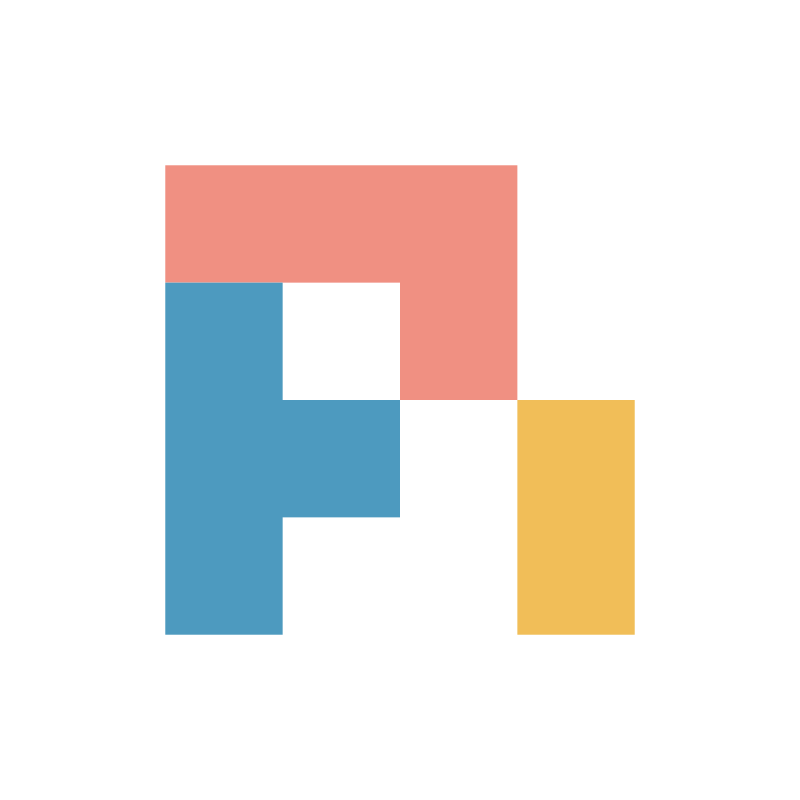

<p align="center">
    &nbsp;&nbsp;
    &nbsp;&nbsp;
    &nbsp;&nbsp;
    &nbsp;&nbsp;
    &nbsp;&nbsp;
    &nbsp;&nbsp;
    &nbsp;&nbsp;
    <picture><source media="(prefers-color-scheme: dark)" srcset="assets/client-icons/opencode-dark.svg"></picture>&nbsp;&nbsp;
    <picture><source media="(prefers-color-scheme: dark)" srcset="assets/client-icons/cline-dark.svg"></picture>&nbsp;&nbsp;
    <picture><source media="(prefers-color-scheme: dark)" srcset="assets/client-icons/windsurf-dark.svg"></picture>&nbsp;&nbsp;
    <picture><source media="(prefers-color-scheme: dark)" srcset="assets/client-icons/grok-dark.svg"></picture>&nbsp;&nbsp;
    <picture><source media="(prefers-color-scheme: dark)" srcset="assets/client-icons/kimi-dark.svg"></picture>&nbsp;&nbsp;
    &nbsp;&nbsp;
    
</p>

[](https://github.com/777genius/universal-agent-plugins/actions/workflows/ci.yml)
[](https://codecov.io/gh/777genius/universal-agent-plugins)
[](https://www.npmjs.com/package/universal-agent-plugins)
[](https://agent-plugins.org/specification)
[](https://agentskills.my/specification)
[](LICENSE)

Install and manage plugins and Skills across your AI agents with one CLI.
Share `uap.toml` (package list) and `uap.lock` (exact versions) to restore your
setup on another computer or with your team.

[Read the documentation](https://universal-agent-plugins.com/docs/) ·
[Browse plugins](https://universal-agent-plugins.com/plugins/) ·
[Build plugins](#build-plugins)

## Contents

- [Use plugins](#use-plugins)
  - [Quick start](#quick-start)
  - [Install the CLI](#install-the-cli)
- [What the CLI does](#what-the-cli-does)
- [Install for one project](#install-for-one-project)
- [Restore your plugin setup](#restore-your-plugin-setup)
- [Install from other sources](#install-from-other-sources)
- [Supported clients](#supported-clients)
- [More commands](#more-commands)
- [Find and verify plugins](#find-and-verify-plugins)
- [Safe updates and removal](#safe-updates-and-removal)
- [SDKs and integrations](#sdks-and-integrations)
- [Build plugins](#build-plugins)
- [Contributing](#contributing)
- [License](#license)

<a href="https://universal-agent-plugins.com/#demo" title="Watch the Universal Agent Plugins demo"></a>

## Use plugins

### Quick start

Install a [supported agent](#supported-clients) first. Then, with Node.js 22+,
add Context7:

```bash
npx universal-agent-plugins add context7
```

Choose from the detected agents, follow any sign-in or approval steps, then
start a new session. This installs for your user account. To keep plugins in
one repository, use [project installation](#install-for-one-project).

**Choose your agents**


**Review the installation plan — Playwright example**


**Follow installation progress — Playwright example**


### Install the CLI

Choose one method. Only npm requires Node.js; Homebrew and the native scripts
do not.

**macOS and Linux — Homebrew:**

```bash
brew install 777genius/agentplugins/agentplugins
agentplugins add context7
```

**macOS and Linux — native installer:**

```bash
curl -fsSL https://raw.githubusercontent.com/777genius/universal-agent-plugins/main/install.sh | sh -s -- add context7
```

**Windows — PowerShell:**

```powershell
irm https://raw.githubusercontent.com/777genius/universal-agent-plugins/main/install.ps1 | iex
& "$HOME\.local\bin\agentplugins.exe" add context7
```

Install the latest CLI with npm (Node.js 22+):

```bash
npm install -g universal-agent-plugins
```

Then run `agentplugins add context7`.

The native scripts verify the download's checksum and version, then install to
`$HOME/.local/bin`. Add that directory to `PATH` to use `agentplugins` by name.
Plugins may need additional runtimes; see [installation help](docs/NATIVE_INSTALL.md).

Version-specific guidance uses [CLI **0.1.95**](https://github.com/777genius/universal-agent-plugins/releases/tag/agentplugins-v0.1.95).
Check `agentplugins version`: npm and Homebrew can lag behind native releases.
Code in `main` may not be released yet.

## What the CLI does

- Installs supported package components in one or more agents.
- Records exact versions for repeatable installs.
- Updates, repairs, and removes managed files without overwriting unrelated content.
- Reports any remaining approval, sign-in, or reload steps.

## Install for one project

Use `--scope project` (CLI 0.1.93+) to install in one repository without changing
your user setup.

**Add a plugin — pinned GitLab example**

Use this complete pinned source, or choose another compatible package from the
[catalog](https://universal-agent-plugins.com/plugins/):

```sh
cd /path/to/project
agentplugins add github:777genius/universal-agent-plugins@2ddbb99dd190c1792b79904f9875e6322bccd243//plugins/gitlab \
  --scope project --target codex
```

Use a full 40-character commit hash; omit `//PACKAGE_PATH` for a root package.
Replace `codex` with your supported agent. Short catalog names such as `context7`
are user-only: they do not work with `--scope project`.

**Share and restore**

Commit the generated `uap.toml` and `uap.lock`; add `.uap/` to `.gitignore`.
In another checkout, install UAP and the required agents, then run from the
project root:

```sh
agentplugins install --locked --scope project
```

`--locked` requires a lockfile matching the manifest and restores its exact versions.

**Add standalone Skills**

```sh
agentplugins skills add owner/repository --ui --scope project
```

Use a real Skills repository; `--ui` opens a browser picker. Outside the project,
add `--project-root /path/to/project`.

Always include `--scope project` with add, update, repair, and remove. Otherwise,
they use your user setup—even inside the project.

ChatGPT has no native project installation. See the
[project guide](docs/PROJECT_INSTALLATION.md) for maintenance and the
[project support table](docs/PROJECT_CLIENT_SUPPORT.md) for each agent's limits.

## Restore your plugin setup

Export your saved user-wide setup to an empty folder:

```sh
agentplugins deps export /path/to/transfer
```

Copy `uap.toml` and `uap.lock` to the new computer, install UAP and the required
agents, then import from the folder containing those files:

```sh
agentplugins deps import /path/to/transfer --install
```

Only `uap.toml` and `uap.lock` travel. These commands use your user setup, not a
project's. Sign-ins, secrets, agent settings, and plugin data need separate setup
or backup. Packages must remain available from their sources or the destination
cache; this is not an offline backup.

Check supported agents with `agentplugins deps status`.
[Dependency guide](docs/UAP_DEPENDENCIES.md) ·
[Import and recovery](https://universal-agent-plugins.com/docs/en/use/manage.html#restore-on-another-machine)

<a id="any-agent-plugins-10-package"></a>

## Install from other sources

Install an Agent Plugins 1.0 package from a local folder, Git (HTTPS or SSH),
or a ZIP/TAR/TAR.GZ archive (local or HTTPS). No catalog entry is required.
Only `plugin.json` is supported as the package manifest:

| File or folder | Purpose |
| --- | --- |
| `plugin.json` | Required package manifest |
| `skills/` | Optional reusable instructions |
| `mcp.json` | Optional MCP servers |
| `hooks/` | Optional client-specific extensions |

Skills are instructions; MCP (Model Context Protocol) servers connect agents to
tools. Both work across supported clients; hooks depend on the client.
See [source formats and credentials](docs/DIRECT_PACKAGE_SOURCES.md).

Standalone `SKILL.md` files use `agentplugins skills add`, not `agentplugins add`.
It accepts GitHub repositories and HTTPS publishers with a Skills index.
Publisher installs need an exact `--skill` name; see the
[Skills guide](docs/AGENT_SKILLS_INSTALLER.md).

## Supported clients

These are installations for your user account. For one repository, see
[project support](docs/PROJECT_CLIENT_SUPPORT.md).

**Prepared** means files or configuration are ready, not that the plugin is
running. Complete any remaining approval, sign-in, or reload steps.

| Client | What UAP sets up |
| --- | --- |
|  Codex | plugin package prepared for Codex |
|  ChatGPT | app setup; Context7 includes guided personal setup (Developer Mode and custom apps required) |
|  Cursor | native plugin with skills and MCP servers |
|  GitHub Copilot CLI | native plugin installed through a managed marketplace |
|  VS Code | plugin package prepared for Copilot |
|  Kiro | skills and MCP setup; OAuth/restart may be required |
|  Claude Code | native Claude Code plugin installation |
|  Gemini CLI | skills and MCP configuration |
| <picture><source media="(prefers-color-scheme: dark)" srcset="assets/client-icons/opencode-dark.svg"></picture> OpenCode | skills and MCP configuration |
| <picture><source media="(prefers-color-scheme: dark)" srcset="assets/client-icons/cline-dark.svg"></picture> Cline | skills and MCP configuration |
| <picture><source media="(prefers-color-scheme: dark)" srcset="assets/client-icons/windsurf-dark.svg"></picture> Windsurf | MCP configured; skills prepared for manual use |
| <picture><source media="(prefers-color-scheme: dark)" srcset="assets/client-icons/grok-dark.svg"></picture> Grok Build | native skills/MCP plugin; Grok CLI install and verification when available |
| <picture><source media="(prefers-color-scheme: dark)" srcset="assets/client-icons/kimi-dark.svg"></picture> Kimi Code | native skills/MCP plugin and managed user registry; reload required |
|  Qoder | native skills/MCP plugin; Qoder CLI install and verification when available |
|  Pi | native extensions (CLI 0.1.95); project support requires a source build |

See the [compatibility reference](https://universal-agent-plugins.com/docs/en/reference/client-compatibility.html)
for tested versions, platforms, and setup steps.

<details>
<summary>Client-specific setup and limits</summary>

CLI 0.1.95 supports [native Pi extensions](docs/PI_NATIVE_EXTENSION_CONTRACT.md)
for your user account. Pi project Extensions, Skills, and MCP support require
newer source builds; they are not included in that release.

Grok Build, Kimi Code, and Qoder support stdio and Streamable HTTP MCP in user
scope. Qoder also preserves native hooks, commands, and bundled binaries.
See [portable commands](docs/UAP_COMMANDS.md) for command delivery and limits.

For guided Context7 setup in ChatGPT and Kiro:

```bash
npx universal-agent-plugins add context7 --target chatgpt,kiro --no-save
```

ChatGPT requires Developer Mode and custom apps. You must install the prepared
package yourself and select it in a new chat. This command uses `--no-save`
because ChatGPT setup cannot be saved as a portable dependency. To save plugins
for other agents, install those separately without `--no-save`.
See the [Context7 setup guide](docs/CONTEXT7_CHATGPT_KIRO_E2E.md).

For Codex, declared MCP SSE is unsupported; use stdio or Streamable HTTP.
See [transport details](docs/CODEX_TRANSPORT_EVIDENCE.md).

</details>

## More commands

Omit `--target` to choose agents interactively; name them explicitly in scripts.

```bash
# Find and inspect packages
agentplugins search docs
agentplugins info context7

# Install in specific agents
agentplugins add context7 --target codex,claude

# Maintain an installed plugin
agentplugins update context7 --target codex,claude
agentplugins repair context7 --target codex,claude
agentplugins remove context7 --target codex,claude
agentplugins outdated --all
agentplugins update --all
agentplugins doctor

# Validate and try a local package
agentplugins validate ./my-plugin
agentplugins add ./my-plugin
```

Local folder installs are not saved as portable dependencies. Use a pinned Git
or HTTPS archive source to restore the package on another computer.

## Find and verify plugins

[Browse the catalog](https://universal-agent-plugins.com/plugins/) or run
`agentplugins search`. Reviewed and unreviewed results are labelled separately.
Discovery is not an endorsement; packages are checked again before installation.

To list a package, see
[registry contributions](https://github.com/777genius/universal-agent-plugins-registry/blob/main/CONTRIBUTING.md).

<a id="lifecycle-safety"></a>

## Safe updates and removal

Use `--dry-run` to preview changes without modifying managed client files.
Security checks may still download scanners or metadata. No install telemetry
is sent.

UAP checks packages, clients, and file ownership before making changes. It
preserves unrelated content and external edits, reports conflicts, and rolls
back failures only where safe. Check every agent's result after a multi-agent
operation: some may succeed while others need attention.

Repair restores managed files. Sign-in and testing inside the agent remain separate.
[Removal and retained data](docs/REMOVAL_SAFETY.md) ·
[Steps requiring your approval](docs/INSTALLER_AUTOMATION_PRINCIPLE.md)

UAP is an independent community project, unaffiliated with OpenAI, Agent Plugins,
or the client vendors.

<a id="already-built-with-uap-sdk"></a>

## SDKs and integrations

<table>
  <tr>
    <td width="104" align="center">
      <a href="https://github.com/777genius/agent-notifications"></a>
    </td>
    <td>
      <strong><a href="https://github.com/777genius/agent-notifications">Agent Notifications</a></strong><br />
      Desktop notifications, sounds, and click-to-focus for AI coding agents.
    </td>
  </tr>
</table>

Use the [Go SDK integration guide](sdk/README.md) for typed agent hooks and
[Go installer components](install/integrationctl/agentplugins/installer/README.md)
to embed plugin management in your app.

The [TypeScript SDK](sdks/typescript/README.md),
`universal-agent-plugins-management-sdk`, calls the CLI's local API (0.1.95+).
Pin compatible SDK and CLI versions separately; see the
[management guide](https://universal-agent-plugins.com/docs/en/use/manage.html#local-management-api).

## Build plugins

Create a package with a root `plugin.json`, with optional `skills/` and `mcp.json`.
Validate and install it with the [local-package commands](#more-commands).
The [Build guide](https://universal-agent-plugins.com/docs/en/build/) covers
Skills and MCP packages; start with the
[Use / Build quickstart](https://universal-agent-plugins.com/docs/en/guide/quickstart.html).

<details>
<summary>Authoring commands (qualified authoring or source build required)</summary>

The current npm and native installer releases do not include `agentplugins author`.
In qualified authoring builds, `agentplugins author` is the public authoring entrypoint.
For example:

```bash
agentplugins author init ./my-plugin --template skill --name my-plugin
agentplugins author validate ./my-plugin
agentplugins author inspect ./my-plugin
agentplugins author test ./my-plugin
```

In qualified/source builds, MCP execution is available through `author test` and `author dev`.
Dependency bootstrap apply currently requires Linux; dry-run planning can be used on other platforms.
Local stdio runtime checks and development require Linux, successful process-containment and bubblewrap preflights, and a supported system Node path.
See the [stdio guide](https://universal-agent-plugins.com/docs/en/build/mcp-stdio.html) for prerequisites.
Client projection, export/bundle, and publication are not exposed by the current authoring CLI.
`plugin.json` is the only supported authoring manifest.

[Native Agent Plugins releases](https://github.com/777genius/universal-agent-plugins/releases)
use `agentplugins-v*` tags; they do not include these authoring commands.

</details>

## Contributing

See [CONTRIBUTING.md](CONTRIBUTING.md) for the development workflow. Run:

```bash
go test ./...
make vet
```

[Security policy](SECURITY.md) · [Support boundary](docs/SUPPORT.md) ·
[Client E2E evidence](docs/AGENTPLUGINS_CLIENT_E2E.md)

## License

[Apache License 2.0](LICENSE). Third-party components retain their original
licenses; see [NOTICE](NOTICE).
